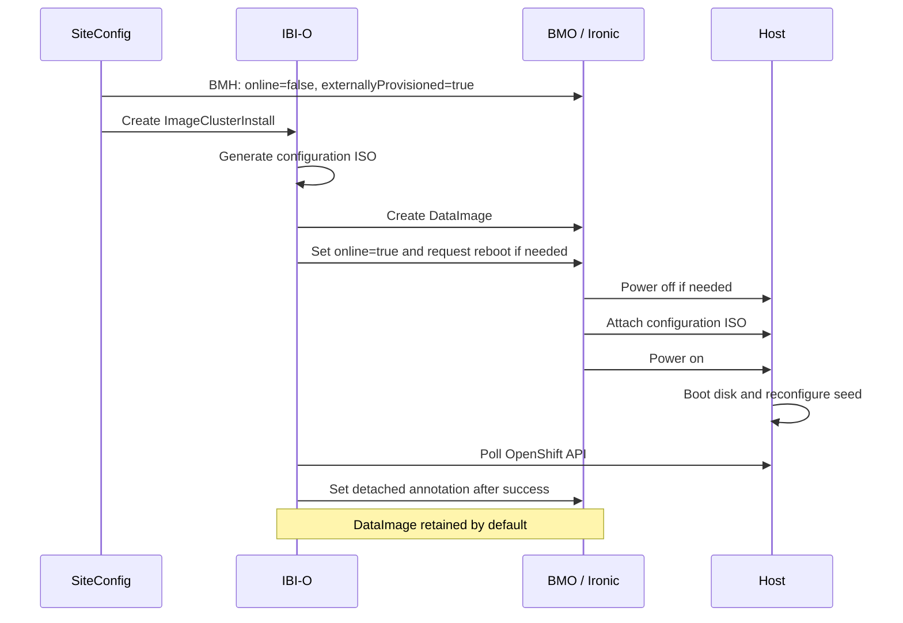

<!--
SPDX-FileCopyrightText: Red Hat

SPDX-License-Identifier: Apache-2.0
-->

# IBI-O installation workflow and Metal3 interactions

The Image Based Install Operator (IBI-O) orchestrates cluster installation by
generating a configuration ISO and updating Kubernetes resources. Bare Metal
Operator (BMO) and Ironic perform the power and virtual-media operations. The
normal IBI installation boots the seed already installed on the host's disk,
with the configuration ISO attached as additional media.

This overview follows the existing installation and cleanup paths. It does not
describe the proposed automated installation of the seed onto an unprepared
server. The observations below come from source analysis, not a new lab test.

## Scope and source revisions

Reviewed on November 20, 2026, using the following source snapshots. Links in
this document are pinned to these revisions so that subsequent changes do not
change the meaning of the references. Behaviour may differ in other releases.

| Component | Source snapshot |
| --- | --- |
| IBI-O | [4bc5f2a6][ibi-revision] |
| BMO | [34bbeb376][bmo-revision], from `release-5.0` |
| Ironic | [7828a100][ironic-revision], from `release-5.0` |
| SiteConfig | [eadd0287][siteconfig-revision] |

## Responsibilities

| Component | Responsibility in this workflow |
| --- | --- |
| SiteConfig | Renders the BareMetalHost (BMH), ImageClusterInstall (ICI), ClusterDeployment and supporting configuration. |
| IBI-O | Builds and serves the configuration ISO, creates the DataImage, requests host startup, monitors cluster readiness and detaches the BMH after success. |
| BMO | Reconciles the BMH's desired power state and reboot requests; handles DataImage attachment/detachment and its finalizer through separate controllers. |
| Ironic | Registers/adopts the host, caches and serves virtual media, and executes power and media operations through its BMC drivers. |
| Host | Boots the installed seed and consumes the configuration ISO to reconfigure it as the requested cluster. |

## Normal installation sequence



The diagram shows logical responsibilities. Resource creation, controller
reconciliation and physical power changes are asynchronous.

### 1. SiteConfig supplies the BMH and ICI

SiteConfig's IBI node template specifies:

```yaml
spec:
  online: false
  externallyProvisioned: true
```

It also supplies the BMC connection, `inspect.metal3.io` annotation and other
host settings. When node networking is configured, the template references an
nmstate Secret through `spec.preprovisioningNetworkDataName`. The ICI references
the BMH by name and namespace; a node's `hostRef` can identify a BMH outside the
cluster namespace. See the [SiteConfig IBI templates][siteconfig-templates].

`externallyProvisioned=true` tells BMO that the host's installation already
exists. It does **not** disable power management or DataImage handling. BMO
registers the host, transitions it into the externally provisioned state and
adopts it in Ironic, without following the ordinary inspection, preparation and
image deployment sequence. See [BMO state transitions][bmo-external-state] and
[steady-state management][bmo-steady-state].

IBI-O uses the referenced BMH; it does not create the BMH itself.

### 2. IBI-O protects the installed seed and validates the host

During configuration validation, IBI-O sets
`spec.automatedCleaningMode=disabled` on the BMH. This prevents automated
cleaning from erasing the installed seed. During host validation, it also
ensures `spec.externallyProvisioned=true`, which normally already comes from
SiteConfig. See [configuration and host validation][ibi-validation].

IBI-O skips its hardware validation when `externallyProvisioned` is true. For
other inputs, inspection settings and BMH readiness determine whether it waits
for inspection results and validates the machine networks. See
[BMH validation][ibi-bmh-validation].

### 3. IBI-O builds and serves the configuration ISO

IBI-O generates `imagebasedconfig.iso` through the OpenShift installer asset
libraries. The ISO contains cluster reconfiguration data, including cluster
identity, credentials and certificates, networking, and additional manifests.
Its contents include `cluster-configuration/manifest.json`; its volume label
is `cluster-config`.

For static networking, IBI-O reads the `nmstate` key from the Secret named by
the BMH's `preprovisioningNetworkDataName`, in the BMH namespace, and passes that
configuration into the installer inputs. It does not change the Secret's
network configuration. See [input generation][ibi-inputs],
[networking input][ibi-network-input] and [configuration ISO generation][ibi-config-iso].

The IBI-O image server exposes the generated file at:

```text
<IBI-O base URL>/images/<ICI namespace>/<ICI UID>.iso
```

The UID distinguishes the files generated for a particular ICI instance. See
[URL construction][ibi-image-url] and the [image server][ibi-image-server].

This is a configuration ISO for the installed seed. IBI-O does not set the
BMH's `spec.image` to this URL or request a boot from this ISO.

### 4. IBI-O creates the DataImage

The DataImage has exactly the same name and namespace as the BMH. Its
`spec.url` references the generated configuration ISO, and its controller owner
reference points to the BMH. IBI-O also labels it for backup.

The existing-object behaviour is significant:

* If no DataImage exists, IBI-O creates it.
* If one exists and is terminating, IBI-O waits and retries.
* If one exists and is not terminating, IBI-O returns it without updating its
  URL or checking that it references the newly generated ISO.

See [ensureBMHDataImage][ibi-dataimage]. BMO's DataImage controller separately
adds the `dataimage.metal3.io` finalizer and ensures a BMH owner reference.
See [DataImage ownership and finalizer handling][bmo-dataimage-controller].

### 5. IBI-O requests startup or a reboot

IBI-O waits for a new DataImage to pass a cooldown period, one second by
default, before updating the BMH. This gives BMO time to observe the resource.
It then waits for the BMH provisioning state to be `available` or
`externally provisioned`. See [host configuration][ibi-configure-host].

On the initial startup request, IBI-O:

* Sets `spec.online=true`.
* Adds `reboot.metal3.io: ""` when
  `DataImage.status.attachedImage.url` is empty.
* Adds `image-based-install-managed: ""` as a one-time startup guard.

If the managed annotation is already present, this function skips these
updates. If the DataImage's attachment URL is already non-empty, it does not
add the reboot annotation. See [updateBMHProvisioningState][ibi-startup].

IBI-O does not first wait for `status.poweredOn=false`. It submits the desired
state and lets BMO perform any required shutdown, attachment and startup.

### 6. BMO attaches the DataImage before powering on

BMO's ordinary power-management path processes DataImage attachment and
detachment when all three conditions hold:

```text
BMH provisioning state is provisioned or externally provisioned
AND BMH.spec.online is true
AND BMH.status.poweredOn is false
```

Creating the DataImage alone does not cause immediate attachment to a running
host. The power transition is the point at which BMO processes it. The BMH
controller gets the DataImage using the BMH's name and namespace. See
[manageHostPower][bmo-power] and [handleDataImageActions][bmo-dataimage-actions].

For a host already powered off, BMO processes the DataImage before powering
on. For a running host, the reboot annotation makes BMO request power-off
while leaving `spec.online=true`. Once the host is off, BMO processes the
DataImage, removes the unsuffixed reboot annotation and proceeds to power-on.
This avoids a second reboot when the host was already off. The empty reboot
annotation requests a soft shutdown by default; the provisioner has fallback
and error handling for power operations. See [reboot annotation parsing][bmo-reboot].

BMO's Ironic provisioner requests attachment as virtual CD media. Ironic's
default download mode is `local`: it downloads/caches the ISO, serves it from
its own web server and passes that served URL to the BMC driver. The Redfish
driver performs the media insertion. See [BMO media operations][bmo-media-api],
[Ironic attachment API][ironic-attach-api], [Ironic media caching][ironic-attach]
and [Redfish media operations][ironic-redfish-media].

IBI-O does not issue Redfish requests or set a boot-device override in this
path. The intended boot is from the installed disk, with the configuration ISO
available to the host's reconfiguration software.

### 7. IBI-O monitors the installed cluster

IBI-O sets ICI `status.bootTime` and `status.bareMetalHostRef` when it submits
the initial host configuration. These fields do not prove that the machine
has booted or that the BMC has attached the ISO. Likewise, the initial
"configuration image is attached" requirements condition follows the startup
guard rather than a strict attachment-status check. See
[startup status updates][ibi-configure-host].

After startup is recorded, the main reconciler normally stops repeating host
configuration while the generated ISO and authentication files exist. A
separate monitor waits for BMH `status.poweredOn=true`, then connects to the
spoke API using its admin kubeconfig. It normally polls installation progress
once per minute. See the [main reconciler][ibi-reconcile] and
[installation monitor][ibi-monitor].

Completion depends on ClusterVersion availability, a freshness check relative
to the reconfiguration marker ConfigMap, and node readiness. IBI-O does not
use SSH polling or an installation-completion callback. See
[cluster readiness checks][ibi-readiness].

Any additional reboots performed by the software running on the host are
separate from the BMH reboot request described above; that guest-side sequence
is outside this source analysis.

### 8. IBI-O detaches the BMH after successful installation

On success, the monitor adds:

```yaml
metadata:
  annotations:
    baremetalhost.metal3.io/detached: imageclusterinstall-controller
```

It then marks installation complete in the ICI conditions. BMO processes the
annotation by removing the host from Ironic management without deprovisioning
it. It keeps the BMH resource and records a detached operational status.
See [IBI-O success handling][ibi-success], [BMO detachment handling][bmo-detach]
and the [Ironic provisioner detach operation][bmo-ironic-detach].

Normal successful completion does not request another reboot, delete the
DataImage or explicitly eject its media. The BMH normally retains
`online=true`, `externallyProvisioned=true`, disabled cleaning and the managed
annotation. The DataImage remains unless a cleanup path is invoked. The
[monitor tests][ibi-success-tests] also explicitly verify retention and detachment.

## Media cleanup and ICI deletion

There are two IBI-O entry points for DataImage cleanup:

* Deleting the ICI invokes its
  `imageclusterinstall.extensions.hive.openshift.io/deprovision` finalizer.
  This also removes the generated files and waits for DataImage deletion
  before removing the ICI finalizer.
* A completed ICI can opt into post-installation cleanup with:

  ```yaml
  metadata:
    annotations:
      imageclusterinstall.extensions.hive.openshift.io/post-cleanup: "true"
  ```

See the [ICI deletion finalizer][ibi-finalizer] and
[optional post-installation cleanup][ibi-post-cleanup]. Normal installation
does not enable that annotation automatically.

Both paths use the same helper sequence:

1. Request deletion of the DataImage.
2. If the BMH still exists, remove its detached annotation.
3. Add the unsuffixed reboot annotation if it is absent.
4. Wait or requeue as needed for DataImage deletion.

The helper leaves `spec.online` unchanged. In the normal installed state it
is true, allowing BMO to regain control, shut down the host, process media
ejection while powered off, and power it on again. The DataImage controller
normally holds its finalizer while media remains inserted. See
[cleanup helpers][ibi-cleanup-helpers] and
[BMO DataImage deletion handling][bmo-dataimage-controller].

**Post-installation cleanup can therefore reboot a running cluster.** In the
reviewed code, the post-cleanup path does not restore the detached annotation
after finishing, and it does not clear the managed annotation or restore the
previous BMH spec values.

### A deleted DataImage does not necessarily prove media ejection

BMO's DataImage controller has a special case for detached hosts: when a
DataImage is being deleted and its BMH is detached, it can remove the finalizer
without checking whether media is still attached. It also removes the
finalizer when the BMH no longer exists. See
[detached and missing-host handling][bmo-dataimage-controller].

IBI-O requests DataImage deletion before removing the BMH's detached
annotation; those operations are not atomic across controllers. The CR's
disappearance alone should therefore not be treated as confirmation of
physical media ejection. This is a source-level ordering consideration, not a
newly reproduced lab result.

## Resource and annotation changes

### BMH fields and metadata written by IBI-O

| Field or metadata | When and why |
| --- | --- |
| `spec.automatedCleaningMode=disabled` | During initial configuration validation, to protect the installed seed. |
| `spec.externallyProvisioned=true` | During host validation, if not already set. |
| `spec.online=true` | During the initial startup request. |
| `image-based-install-managed: ""` annotation | During initial startup; prevents repeating the startup changes. Retained afterwards. |
| `reboot.metal3.io: ""` annotation | During initial startup when the DataImage's attachment URL is empty, and during media cleanup. BMO consumes/removes it. |
| `baremetalhost.metal3.io/detached: imageclusterinstall-controller` annotation | Added after successful installation, if absent; removed during cleanup. |
| `cluster.open-cluster-management.io/backup=true` label | Applied to the BMH and DataImage for backup. |

The field and annotation changes are in [validation][ibi-validation],
[startup][ibi-startup], [success handling][ibi-success] and
[cleanup][ibi-cleanup-helpers]. Backup metadata is applied by the
[backup labelling helpers][ibi-backup]. The backup entry is a **label**, not an
annotation.

IBI-O reads `inspect.metal3.io` for host validation but does not modify it. It
does not directly change the BMH's `spec.image`, `consumerRef`, BMC connection,
owner references, status or finalizers in this installation path.

### Other Metal3 resources

IBI-O's Metal3 writes in the reviewed installation code are limited to the BMH
changes above and DataImage creation, backup labelling and deletion. It does
not create or modify PreprovisioningImage, HardwareData, firmware or RAID CRs.
The nmstate Secret is read as configuration input. BMO may independently
manage related resources and protection finalizers as part of its own
reconciliation.

The DataImage's BMH controller owner reference is created by IBI-O. Its
`dataimage.metal3.io` finalizer and status are managed by BMO, not IBI-O. The
DataImage controller observes media and handles lifecycle protection; actual
attachment and detachment are driven by the BMH controller's power-management
path. See [DataImage creation][ibi-dataimage],
[DataImage controller][bmo-dataimage-controller] and
[BMH media handling][bmo-dataimage-actions].

## Implications for automated seed pre-provisioning

The existing workflow provides useful pieces for a future handoff, but several
contracts must be handled explicitly:

* **Attachment depends on host state.** The ordinary DataImage path attaches
  while an already provisioned or externally provisioned host is powered off
  with `online=true`. It is not a general pre-deployment attachment hook.
* **An existing DataImage is reused.** If seed pre-provisioning and cluster
  reconfiguration use different ISO contents or URLs, the transition must
  explicitly update or replace the DataImage; IBI-O does not do so on finding
  an existing object.
* **The managed annotation persists.** Its presence makes IBI-O skip its
  initial startup mutation, so it cannot be treated as an unrelated marker
  when defining a new installation attempt.
* **Detachment is part of successful completion.** A subsequent operation that
  needs BMO control must explicitly account for reattachment and power state.
* **Cleanup and ejection are distinct observations.** Deletion of a CR is not
  sufficient evidence that its media has been ejected.
* **Attachment status is not an exact media identity check.** BMO records the
  requested attachment URL optimistically after the attach call. Its
  provisioner checks whether any virtual-media device is inserted, rather than
  verifying that a particular device holds the requested ISO. This matters if
  more than one ISO is present. See [attachment status bookkeeping][bmo-attach-status]
  and [media presence checks][bmo-media-presence].

These observations describe the existing interfaces and their limits. They do
not select an implementation for the proposed pre-provisioning feature.

[ibi-revision]: https://github.com/openshift/image-based-install-operator/commit/4bc5f2a691cab4b02638dfd6bd567cd0cf2f9408
[bmo-revision]: https://github.com/openshift/baremetal-operator/commit/34bbeb376836bf01793d4e70d29065d619ebcaa1
[ironic-revision]: https://github.com/openshift/openstack-ironic/commit/7828a10082034f48ca1d6d305a6766cddb160da4
[siteconfig-revision]: https://github.com/stolostron/siteconfig/commit/eadd0287e113d26400229d62ee0683098eb85b85
[siteconfig-templates]: https://github.com/stolostron/siteconfig/blob/eadd0287e113d26400229d62ee0683098eb85b85/internal/templates/image-based-installer/template.go#L89
[ibi-reconcile]: https://github.com/openshift/image-based-install-operator/blob/4bc5f2a691cab4b02638dfd6bd567cd0cf2f9408/controllers/imageclusterinstall_controller.go#L135
[ibi-validation]: https://github.com/openshift/image-based-install-operator/blob/4bc5f2a691cab4b02638dfd6bd567cd0cf2f9408/controllers/imageclusterinstall_controller.go#L278
[ibi-bmh-validation]: https://github.com/openshift/image-based-install-operator/blob/4bc5f2a691cab4b02638dfd6bd567cd0cf2f9408/controllers/imageclusterinstall_controller.go#L446
[ibi-inputs]: https://github.com/openshift/image-based-install-operator/blob/4bc5f2a691cab4b02638dfd6bd567cd0cf2f9408/controllers/imageclusterinstall_controller.go#L937
[ibi-network-input]: https://github.com/openshift/image-based-install-operator/blob/4bc5f2a691cab4b02638dfd6bd567cd0cf2f9408/controllers/imageclusterinstall_controller.go#L1105
[ibi-config-iso]: https://github.com/openshift/image-based-install-operator/blob/4bc5f2a691cab4b02638dfd6bd567cd0cf2f9408/vendor/github.com/openshift/installer/pkg/asset/imagebased/configimage/configiso.go#L15
[ibi-image-url]: https://github.com/openshift/image-based-install-operator/blob/4bc5f2a691cab4b02638dfd6bd567cd0cf2f9408/controllers/imageclusterinstall_controller.go#L351
[ibi-image-server]: https://github.com/openshift/image-based-install-operator/blob/4bc5f2a691cab4b02638dfd6bd567cd0cf2f9408/internal/imageserver/imageserver.go#L20
[ibi-dataimage]: https://github.com/openshift/image-based-install-operator/blob/4bc5f2a691cab4b02638dfd6bd567cd0cf2f9408/controllers/imageclusterinstall_controller.go#L751
[ibi-configure-host]: https://github.com/openshift/image-based-install-operator/blob/4bc5f2a691cab4b02638dfd6bd567cd0cf2f9408/controllers/imageclusterinstall_controller.go#L384
[ibi-startup]: https://github.com/openshift/image-based-install-operator/blob/4bc5f2a691cab4b02638dfd6bd567cd0cf2f9408/controllers/imageclusterinstall_controller.go#L721
[ibi-monitor]: https://github.com/openshift/image-based-install-operator/blob/4bc5f2a691cab4b02638dfd6bd567cd0cf2f9408/controllers/imageclusterinstall_monitor.go#L84
[ibi-readiness]: https://github.com/openshift/image-based-install-operator/blob/4bc5f2a691cab4b02638dfd6bd567cd0cf2f9408/internal/monitor/monitor.go#L50
[ibi-success]: https://github.com/openshift/image-based-install-operator/blob/4bc5f2a691cab4b02638dfd6bd567cd0cf2f9408/controllers/imageclusterinstall_monitor.go#L143
[ibi-success-tests]: https://github.com/openshift/image-based-install-operator/blob/4bc5f2a691cab4b02638dfd6bd567cd0cf2f9408/controllers/imageclusterinstall_monitor_test.go#L165
[ibi-finalizer]: https://github.com/openshift/image-based-install-operator/blob/4bc5f2a691cab4b02638dfd6bd567cd0cf2f9408/controllers/imageclusterinstall_controller.go#L1301
[ibi-cleanup-helpers]: https://github.com/openshift/image-based-install-operator/blob/4bc5f2a691cab4b02638dfd6bd567cd0cf2f9408/controllers/common.go#L45
[ibi-post-cleanup]: https://github.com/openshift/image-based-install-operator/blob/4bc5f2a691cab4b02638dfd6bd567cd0cf2f9408/controllers/common.go#L129
[ibi-backup]: https://github.com/openshift/image-based-install-operator/blob/4bc5f2a691cab4b02638dfd6bd567cd0cf2f9408/controllers/imageclusterinstall_controller.go#L806
[bmo-external-state]: https://github.com/openshift/baremetal-operator/blob/34bbeb376836bf01793d4e70d29065d619ebcaa1/internal/controller/metal3.io/host_state_machine.go#L408
[bmo-steady-state]: https://github.com/openshift/baremetal-operator/blob/34bbeb376836bf01793d4e70d29065d619ebcaa1/internal/controller/metal3.io/baremetalhost_controller.go#L2019
[bmo-dataimage-controller]: https://github.com/openshift/baremetal-operator/blob/34bbeb376836bf01793d4e70d29065d619ebcaa1/internal/controller/metal3.io/dataimage_controller.go#L97
[bmo-power]: https://github.com/openshift/baremetal-operator/blob/34bbeb376836bf01793d4e70d29065d619ebcaa1/internal/controller/metal3.io/baremetalhost_controller.go#L1680
[bmo-dataimage-actions]: https://github.com/openshift/baremetal-operator/blob/34bbeb376836bf01793d4e70d29065d619ebcaa1/internal/controller/metal3.io/baremetalhost_controller.go#L1825
[bmo-reboot]: https://github.com/openshift/baremetal-operator/blob/34bbeb376836bf01793d4e70d29065d619ebcaa1/internal/controller/metal3.io/baremetalhost_controller.go#L435
[bmo-media-api]: https://github.com/openshift/baremetal-operator/blob/34bbeb376836bf01793d4e70d29065d619ebcaa1/pkg/provisioner/ironic/ironic.go#L2024
[bmo-detach]: https://github.com/openshift/baremetal-operator/blob/34bbeb376836bf01793d4e70d29065d619ebcaa1/internal/controller/metal3.io/host_state_machine.go#L293
[bmo-ironic-detach]: https://github.com/openshift/baremetal-operator/blob/34bbeb376836bf01793d4e70d29065d619ebcaa1/pkg/provisioner/ironic/ironic.go#L1634
[bmo-attach-status]: https://github.com/openshift/baremetal-operator/blob/34bbeb376836bf01793d4e70d29065d619ebcaa1/internal/controller/metal3.io/baremetalhost_controller.go#L1962
[bmo-media-presence]: https://github.com/openshift/baremetal-operator/blob/34bbeb376836bf01793d4e70d29065d619ebcaa1/pkg/provisioner/ironic/ironic.go#L1977
[ironic-attach-api]: https://github.com/openshift/openstack-ironic/blob/7828a10082034f48ca1d6d305a6766cddb160da4/ironic/conductor/manager.py#L4376
[ironic-attach]: https://github.com/openshift/openstack-ironic/blob/7828a10082034f48ca1d6d305a6766cddb160da4/ironic/conductor/manager.py#L4699
[ironic-redfish-media]: https://github.com/openshift/openstack-ironic/blob/7828a10082034f48ca1d6d305a6766cddb160da4/ironic/drivers/modules/redfish/management.py#L1818
