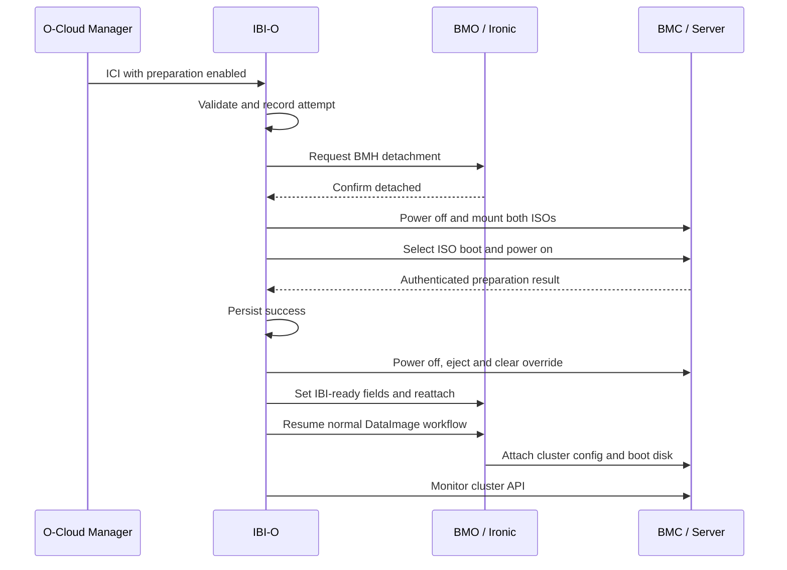

<!--
SPDX-FileCopyrightText: Red Hat

SPDX-License-Identifier: Apache-2.0
-->

# Proposal: IBI server pre-provisioning through direct Redfish control

Status: Draft for discussion. No implementation or supported hardware contract
is selected by this document.

## Summary

Extend the Image Based Install Operator (IBI-O) to perform the preparation boot
through direct Redfish operations, temporarily taking control of a server away
from Bare Metal Operator (BMO) and Ironic. IBI-O would mount the shared IBI live
ISO and a per-attempt configuration ISO, power on the server, monitor seed
installation, then power off and eject the media before returning control to
BMO for normal IBI cluster installation.

This is an alternative boot mechanism for
[Automated IBI Server Pre-Provisioning](./ibi-server-pre-provisioning.md),
associated with CNF-26353. It preserves that proposal's ProvisioningRequest,
hardware allocation, BareMetalHost (BMH), ImageClusterInstall (ICI) and callback
workflow. It does not introduce a separate fleet-preparation CR or remove the
requirement for a BMH.

The intended benefit is to deliver preparation without changes to BMO,
Ironic or Metal3 CRDs. In exchange, IBI-O would own Redfish compatibility,
media delivery and the temporary transfer of BMC control. This benefit remains
subject to proving the complete preparation and handoff sequence against
unmodified platform components.

## Background and motivation

Current IBI installation assumes the seed is already installed on disk.
IBI-O builds a configuration ISO, creates a DataImage, sets BMH `online=true`
and requests a reboot when needed. BMO attaches the configuration ISO before
powering on an already provisioned or externally provisioned host. IBI-O
subsequently monitors the cluster API and detaches the BMH after success.
See the [existing installation workflow](../dev/ibi-installation-workflow.md)
for the complete sequence, resource changes and cleanup behaviour, with links
to the reviewed source revisions.

The original pre-provisioning proposal adds an earlier boot of the IBI live
ISO, with per-host configuration on a second ISO. Investigation found that
stock BMO does not attach a DataImage before the initial live-ISO deployment
boot. That deployment uses a different path from the steady-state power
management path that processes DataImages. Stock BMO also omits the provisioning
configdrive for live-ISO deployment. See [BMO's attachment gate][bmo-power] and
[live-ISO configdrive handling][bmo-configdrive].

One approach is to extend BMO to pass the configuration ISO into Ironic's
existing pre-power-on configdrive hook and adjust Ironic's media selection to
preserve both images. A prototype passed the first cold-boot media-delivery
checkpoint on the tested iDRAC on November 23, 2026; see the
[Metal3 configuration-media proposal](https://github.com/openshift-kni/oran-o2ims/pull/5477).
That result applies to the BMO/Ironic extension, while control transfer,
preparation and handoff remain acceptance gates for this direct Redfish
alternative. The extension adds cross-project review, release and delivery
dependencies; this proposal considers performing those media and power
operations within IBI-O instead.

### What has been demonstrated

Investigation on November 20, 2026 used OpenShift 5.0.2, ACM/MCE 5.0.0 and a
Dell PowerEdge XR8620t with iDRAC firmware 7.30.30.51:

* Stock BMO/Ironic booted a diagnostic live ISO but did not attach a
  pre-created configuration DataImage for that initial boot.
* A direct, slot-specific Redfish insertion into a second System-level
  VirtualMedia resource preserved the running live ISO. The guest could read
  both ISOs and verify the configuration ISO's bytes.
* Selectively ejecting the second image preserved the first image and the
  running guest. The legacy Manager media view did not show the same complete
  media inventory as the System-level view.

The preparation service was masked during those tests. They demonstrate
simultaneous media on that hardware and firmware, not cold-boot delivery,
successful preparation, static networking, callbacks, recovery or handoff.
Those remain acceptance gates for this alternative.

## Scope

In scope:

* Optional preparation of a server already represented by a BMH and selected
  for an ICI, including consumers other than O-Cloud Manager.
* A confirmed transfer of control from BMO/Ironic to IBI-O and back.
* Direct Redfish media insertion, boot selection and power operations.
* Per-attempt configuration delivery and authenticated completion monitoring.
* Durable progress, bounded retries, cancellation and cleanup.
* Resumption of the existing IBI configuration and cluster-readiness workflow.

Out of scope:

* Direct BMC control from O-Cloud Manager.
* Offline preparation of arbitrary BMC lists without BMHs or ICIs.
* Changes to BMO, Ironic or Metal3 CRDs for the proposed implementation.
* Bypassing hardware allocation, inspection or firmware requirements imposed by
  the provisioning workflow before IBI-O takes control.
* An implicit fallback that regenerates a boot ISO per host when a BMC cannot
  present two images. Such a fallback would need a separate design decision.

## Architecture and responsibilities

| Component | Responsibility |
| --- | --- |
| O-Cloud Manager | Validate preparation inputs, allocate hardware, populate the ICI through SiteConfig and report progress. On deletion, cancel preparation and wait for cleanup/release acknowledgement before deleting the allocation. |
| SiteConfig | Render the BMH, ICI and supporting resources while preserving the agreed preparation and control-transfer metadata. |
| IBI-O | Own the preparation attempt, acquire BMC control, publish configuration media, perform Redfish operations, accept completion, clean up and hand control back. |
| BMO/Ironic | Finish existing work, acknowledge detachment, and resume normal management after IBI-O releases the host. They do not mount preparation media in this design. |
| Live ISO | Discover its configuration media, initialize networking, run seed installation and report the result for the current attempt. |

The new Redfish operations should use a Go client library behind a small
interface in IBI-O, allowing discovery, vendor adaptations and deterministic
tests. They do not require another CLI/tooling container image.

### Detachment is the control-transfer mechanism

Setting `baremetalhost.metal3.io/paused` stops BMO reconciliation, but does not
cancel work already submitted to Ironic or remove its host record. Ironic has
independent power reconciliation and may undo an out-of-band power change.
Pausing alone is therefore insufficient. See [BMO pause handling][bmo-pause]
and [Ironic power reconciliation][ironic-power].

Use `baremetalhost.metal3.io/detached` and wait for
`status.operationalStatus=detached`. BMO removes the host from Ironic without
deprovisioning it, and recreates its registration when the annotation is
removed. Metal3 documents detachment as a way to transfer management to another
system temporarily. It is supported in stable states including `available`
and `externally provisioned`. See the
[Metal3 detachment documentation][metal3-detach] and
[reviewed BMO implementation][bmo-detach].

IBI-O must not pause BMO before requesting detachment, because BMO needs to
reconcile that request. An additional pause is not part of this design unless
the prototype demonstrates a separate need. While detached, BMH power and
DataImage status can be stale; IBI-O observes actual hardware through Redfish.

## Proposed workflow



The diagram shows the successful path. Every transition involving an external
side effect needs a persisted intent, observed result and restart behaviour.

### 1. Gate normal installation and validate the target

Enter preparation handling when it is requested **or a persisted attempt is
active**, before the existing host-validation and startup code can set
`externallyProvisioned`, set `online=true`, add the managed annotation or
start cluster monitoring. Acquiring control, cleanup and handoff are active
attempt states. Clearing a spec field must not bypass that gate while an
attempt still owns or is releasing the host.
Preparation success must not set the ICI's overall installation-completed
condition or the existing `status.bootTime`; those belong to the later cluster
configuration stage. See the [existing reconcile order][ibi-reconcile].

The existing SiteConfig IBI template already sets `online=false` and
`externallyProvisioned=true`. Direct Redfish preparation does not require
changing the latter to false, because BMO is never asked to deploy the live
ISO. These fields are not preparation-completion signals: the ICI gate and
attempt result determine that. Hardware allocation and any required inspection
must finish before the host is handed to this stage. A consumer that supplies
an `available` BMH with `externallyProvisioned=false` can also use the stable
detachment path; IBI-O sets the final IBI-ready fields only after preparation.

Validate the ICI/BMH association and target identity, required BMC credentials,
Redfish support, ISO references and endpoint configuration. Reject a deleting
BMH, an unrelated pause/detachment or an existing preparation claim owned by
another ICI. A fresh attempt must not overwrite another deployment's
`spec.image`, DataImage or managed marker.

Before any destructive operation, establish exclusive ownership for the ICI
UID and preparation attempt. The claim must cover both competing ICIs and
duplicate BMHs that refer to the same physical server through different
addresses. A Kubernetes Lease or equivalent persisted claim is a candidate;
its exact representation is a design decision to settle before implementation.
Lease expiry alone must not authorize a new installation while an earlier
attempt may still be running.

Before requesting detachment, persist a snapshot of the ICI UID, attempt ID,
BMH name/namespace/UID, selected BMC/System identity, live ISO URL/digest,
preparation inputs and credential references. Keep secret values in Secrets.
Drive reconciliation and cleanup from that snapshot until the attempt has
completed or acknowledged cancellation and released control. Re-read resource
identities to detect replacement; do not retarget a claimed attempt using a
new BMH or ICI spec.

The existing [ICI update webhook][ibi-update-validation] freezes most spec
fields only after `status.bareMetalHostRef` is set by normal startup. Extend
validation to reject preparation-input and target changes once the preparation
attempt is claimed, including removing or disabling preparation while that
attempt is active. Keep safe metadata updates allowed, and constrain the
existing `spec.clusterMetadata` exemption so it cannot alter claimed inputs.
Use an explicit cancellation intent for cancellation, and keep the preparation
gate active through cleanup; unsetting preparation is not a request to start
normal installation. Do not set normal-installation status early merely to
activate the old webhook guard.

Retain the input guard through handoff and the transition to normal startup;
a preparation success result must never authorize an edited target or a
different set of preparation inputs during that transition.

### 2. Acquire control from BMO/Ironic

Wait for outstanding hardware work to reach an eligible stable state. Record
the attempt's control-acquisition intent, apply the detached annotation and
wait for BMO to acknowledge it. Do not force-detach an actively provisioning,
cleaning or servicing host to start preparation.

An annotation being present is not the acknowledgement. IBI-O begins direct
power/media mutations only after confirmed detachment. Record the BMH UID,
selected Redfish System identity and ownership metadata so retries can verify
the same target. Do not remove a pre-existing detachment owned by another
workflow.

### 3. Generate and publish preparation configuration

Create immutable per-attempt configuration media containing the networking
input and completion-reporting configuration. Its identity includes the ICI UID
and attempt ID. Reuse the existing ISO-building infrastructure and nmstate
representation where practical; the payload extension needs a defined version
and purpose so the guest cannot confuse preparation data with final cluster
reconfiguration data.

The preparation ISO and the later cluster configuration ISO have separate
lifecycles and URLs. Do not overwrite an artifact that a BMC may still fetch.
Persist the artifact identity before requesting a mount, and retain it until
the attempt's media cleanup has been verified.

A DataImage CR is not required to make Redfish mount this preparation ISO.
The preferred starting point is an IBI-O-owned artifact referenced by attempt
state; reserve the BMH-named DataImage for normal cluster configuration. If
compatibility with the original proposal requires a preparation DataImage,
treat it only as a carrier record while detached, and remove it after verified
ejection before handing back control. Do not fabricate its attachment status.

### 4. Mount both images and boot the server

Use the BMC address, System selection and credential references recorded when
claiming the BMH. Revalidate its UID and the physical identity. Complete
the [ISO artifact checks](#live-iso-artifact-validation) and media inventory
before changing power state, media or boot selection.

Discover VirtualMedia resources and their advertised actions and capabilities.
Reject unrelated inserted media before preparation, even if two other devices
are free. Do not eject that media to make preflight pass. This conservative
policy covers the complete workflow: the later stock Ironic path used for the
final configuration DataImage [ejects matching media before insertion][ironic-insertion],
so preserving an unrelated ISO during direct preparation alone would not
protect it through handoff.

Select two independently usable, empty devices. Do not assume fixed iDRAC
resource paths or count System and Manager aliases as independent devices. If
two usable devices cannot be established, fail before power-on with a specific
unsupported-capability result. Once preflight passes, confirm power-off through
Redfish before inserting media or changing boot selection.

Mount the live ISO and preparation ISO using the selected resources. Wait for
asynchronous operations and verify that both images are inserted; a successful
POST alone is insufficient. Record device identities and the attempt's media
references. Set a one-time boot override for the live ISO and power on.

The prototype must prove that the boot selection chooses the live ISO when
both media devices are present. It must also prove both images are readable
inside the guest before seed installation starts. The live ISO URL stays out
of `BMH.spec.image` throughout this direct-boot path.

### 5. Monitor preparation

Retain the original proposal's authenticated callback design. The reusable
live ISO includes a generic configuration loader and result reporter; the
per-attempt ISO supplies the callback address, attempt ID, credential and
networking. Validate that a result belongs to the current ICI UID and attempt,
persist it through the Kubernetes API, and handle duplicate delivery
idempotently.

IBI-O's manager and image server run as separate processes. Callback state
must not rely on shared in-memory state. Power-on, a readable ISO and BMH
`provisioned` status are not evidence that seed installation finished.

SSH polling remains an alternative monitoring design, requiring a private-key
Secret, host addressing and host-key trust. Direct Redfish boot does not
require changing the chosen completion-monitoring mechanism.

### 6. Verify cleanup and record readiness for handoff

On an authenticated success result, persist preparation success before
starting cleanup. Confirm the server is powered off, eject the two images
owned by this attempt and verify their removal. Clear the temporary boot
override so the next boot uses the installed disk. Remove preparation carrier
records only after physical cleanup; do not infer ejection from DataImage CR
deletion.

While the BMH remains detached, ensure:

```yaml
spec:
  automatedCleaningMode: disabled
  externallyProvisioned: true
  online: false
```

`spec.image` must remain unset, and no preparation-owned reboot request or
managed marker may cause an extra boot or bypass normal IBI-O startup. Any
preparation DataImage must be gone before the final configuration DataImage is
created: existing IBI-O reuses an existing DataImage without changing its URL.
See [DataImage creation/reuse][ibi-dataimage].

Repeat the media inventory before releasing control. If unrelated media has
appeared during the attempt, preserve it, retain the claim and detachment,
and report blocked handoff for resolution. Do not allow normal Ironic media
attachment to remove it indirectly. A restart must apply this same check.

### 7. Release control and resume normal IBI installation

Persist a handoff-pending state after successful preparation and cleanup, then
remove only this attempt's detachment annotation. Wait for normal BMO
management to resume and record that control was released. Resume the existing
IBI-O flow: generate the cluster configuration ISO, create its DataImage,
request disk boot and monitor cluster readiness.

A restart between reattachment and the final status update must resume the
handoff, not restart preparation. Once control is released, preparation code
must not issue further Redfish mutations. Normal IBI-O detachment at the end
of cluster installation remains unchanged.

## Media delivery and networking

Direct mounting removes Ironic's current download/cache/rehosting step from
the preparation path. Both source URLs must therefore work from the BMC's
network, using its DNS, routing, HTTPS and authentication capabilities. An
endpoint working from a hub pod or administrator workstation does not establish
that it works from the BMC.

The live ISO can use the existing published HTTPS artifact if the BMC can
retrieve it and the artifact validation below passes. The preparation ISO needs
a BMC-reachable endpoint: the current IBI-O image URL uses a cluster-internal
`.svc` hostname. A Route, externally
reachable service or separately designed media proxy is required. Do not rely
on Ironic's private filesystem or APIs to serve it. See
[current IBI-O URL construction][ibi-service-url].

### Live ISO artifact validation

Retain the original proposal's
[artifact-binding and origin requirements](./ibi-server-pre-provisioning.md#3-bmh-image-configuration-for-iso-boot)
for the direct Redfish path. For a new preparation attempt, complete these
checks before any media insertion or power mutation:

* Require `isoDigest` for automated boot and validate the ISO URL against an
  operator-controlled origin allowlist before fetching any bytes. A request
  or template must not be able to widen that allowlist.
* Fetch the actual ISO bytes over HTTPS, using the configured ISO-server CA
  or system roots, and compare their SHA-256 to the claimed `isoDigest`.
  A matching checksum sidecar is not a substitute for hashing the ISO bytes.
* Reject redirects and require a direct artifact URL. Reject digest mismatch,
  missing digest, disallowed origin and failed TLS validation before inserting
  either ISO or issuing a power operation.
* Require an immutable per-generation URL on the approved origin. Its bytes
  must remain unchanged and available while the BMC can fetch or retry them.

Persist the verified URL/digest with the claimed attempt. The BMC downloads
the image later, so a successful pre-fetch alone does not bind those later
bytes. Immutability is a producer/publication contract, not something a generic
webhook can prove from a URL string. Environments unable to provide that
contract cannot enable this direct-boot path; do not downgrade to URL-only
trust after a successful hash check.
Cancellation and cleanup use the persisted attempt and must not require the
ISO origin to remain reachable or pass another verification fetch.

### Preparation-only BMC endpoint

Expose only preparation-owned media through the new BMC-facing endpoint.
The existing [IBI-O image handler][ibi-image-handler] serves `/images/` without
request authentication; those final cluster configuration ISOs can contain
credentials. Exposing the whole image service through a new Route would also
expose that unrelated content.

Use a separate listener registering only preparation-media handlers and expose
it through its own Service, or use an HTTPS endpoint with an enforced path
restriction that exposes only the preparation prefix. A second Service pointing
to the existing unrestricted listener would not establish that boundary. The
restriction must hold with the selected TLS and routing configuration; a URL
naming convention is insufficient. A preparation download credential must not
authorize access to final configuration media. Verify that `/images/` cannot
be fetched through the new BMC-facing endpoint, including during and after
handoff.

The preparation payload contains an attempt credential and possibly sensitive
network configuration. Its download authorization must be scoped, bounded in
lifetime and compatible with BMC retries and range requests. Keep download and
callback credentials separate, and do not log credential-bearing URLs. The
serving mechanism and BMC support matrix are prerequisites for selecting this
alternative, not deferred deployment details.

There are separate trust relationships for IBI-O-to-BMC API calls,
BMC-to-ISO-server downloads and guest-to-callback-server requests. The BMH's
`disableCertificateVerification` setting concerns the first; it does not by
itself configure BMC trust of an HTTPS ISO server.

Attaching networking data also does not automatically configure the guest.
The live ISO needs a generic loader that finds and validates the preparation
media and applies networking before seed-image downloads and callbacks. Static
networking without DHCP remains unproven until that ordering is exercised.
Until then, tests need working DHCP. Callback monitoring avoids requiring a
hub-initiated SSH connection but still requires guest-to-hub connectivity.

## Recovery, retries and deletion

Attempt state must distinguish acquiring control, mounting, booting, waiting
for completion, cleaning up, handing off and completion. Store identifiers,
intent and observed progress in API status; keep credentials in Secrets.
Redfish calls need bounded timeouts and task monitoring rather than a long
blocking reconcile.

| Situation | Required behaviour |
| --- | --- |
| IBI-O restarts or leader changes | Reclaim only its recorded attempt, inspect physical state and resume. Do not repeat destructive installation because a status write was lost. |
| A Redfish request times out | Determine whether the operation took effect before retrying. Track asynchronous task references where supported. |
| Installation fails or its callback times out | Report the distinction, invalidate the old result credential, power off and clean up owned media before retrying. A missing callback does not prove the installer stopped. |
| Callback arrives after cancellation/retry | Reject the retired attempt's result. Keep duplicate results for the current attempt idempotent. |
| Cleanup or BMC access fails | Keep ownership recorded, report the blocked cleanup and retry. Do not declare the host ready or start another attempt. |
| Claimed ICI target or preparation spec is edited | Reject the change. Reconcile the recorded attempt until completion or acknowledged cancellation and release; do not enter normal startup from the edited spec. |
| ProvisioningRequest is deleted during preparation | Persist cancellation, block new attempts and retain the NAR/allocation until IBI-O acknowledges cleanup and release for the affected attempt. |
| ICI is deleted during preparation | Stop normal progress and use an explicit finalizer to quiesce the attempt, clean up and release the host. Surface failures without silently abandoning the pause/detachment or ownership claim. |
| Deletion occurs after handoff | Use existing IBI-O cleanup; the preparation path must not retake BMC control. |

Use separate bounded budgets for control acquisition, preparation and cleanup.
Record the boot request only when it is applied or reliably observed, and do
not reset the installation timeout on each reconcile. Retry starts a new
attempt only after cleanup and backoff; it cannot inherit a stale success
result or bearer token.

Deleting the ICI or losing a callback must not strand an unmanaged running
installer or permit BMO to clean its disks. The deletion handoff needs an
explicit safe-state contract with the existing ICI finalizer and the caller's
deletion workflow. Keep cleaning disabled while installed data is being
preserved, and never work around a failure by deleting BMH status or removing
another controller's finalizer.

Preparation cleanup must finish before the existing ICI deletion finalizer is
allowed to remove the normal DataImage, reattach the BMH or request a reboot.
The two cleanup paths must not run independently while preparation still owns
the BMC.

### Parent deletion must wait before releasing allocation

An ICI finalizer alone cannot enforce this ordering. O-Cloud Manager's
[ProvisioningRequest deletion path][pr-deletion-order] deletes the
NodeAllocationRequest (NAR) before the ClusterInstance. NAR/AllocatedNode
cleanup can therefore [remove allocation labels and change BMH cleaning and
power settings][hardware-release] before ICI deletion reaches IBI-O.
Detachment does not protect those Kubernetes fields or reserve the allocation.

Add a preparation-cancellation barrier in `handleProvisioningRequestDeletion`
before deleting the NAR:

1. Persist cancellation intent for the associated ICI/attempt and prevent new
   preparation attempts for the deleting request. Cancellation must remain
   effective across parent and IBI-O restarts and must not depend on disabling
   preparation in the ICI spec.
2. IBI-O uses the recorded target to invalidate the attempt's callback
   credential, quiesce installation, power off, remove owned media, clear its
   boot override and release BMC control. Keep unrelated media protected by
   the handoff checks above.
3. Persist an acknowledgement tied to the ICI UID and affected attempt,
   confirming cleanup and release. An absent callback, expired Lease, missing
   pod or empty attempt status is not sufficient evidence. Cancellation must
   also prevent a late reconcile from claiming or restarting preparation.
4. Only after that acknowledgement may O-Cloud Manager continue its existing
   NAR-first deletion sequence. It must retain allocation and report blocked
   cleanup while IBI-O cannot safely release the host.

Define the cancellation and acknowledgement API with IBI-O and SiteConfig
so normal rendering cannot overwrite the intent. Keep the ICI finalizer for
direct ICI deletion and make later child cleanup idempotent after the parent
barrier has completed. Do not solve this by globally reversing the existing
NAR/ClusterInstance deletion order.

## Expected implementation changes

| Area | Expected changes |
| --- | --- |
| IBI-O API and validation | Preparation inputs, claimed input snapshot, input freezing, cancellation/acknowledgement, durable status, conditions and generated CRDs. Preserve installation when preparation is absent. |
| IBI-O controller | Gate on requested or persisted preparation before normal startup; reconcile claimed inputs through cancellation, cleanup and handoff; validate ISO bytes and origin before BMC mutations. |
| IBI-O BMC client | New Redfish interface and implementation with discovery, credentials/TLS, asynchronous tasks, media identity, selective ejection and retry handling. |
| IBI-O image/callback server | Versioned preparation ISO content, protected preparation-only BMC endpoint, callback authentication and durable result recording. Keep final `/images/` inaccessible through the new endpoint. |
| Live ISO generation | Add generic preparation-media/network bootstrap and reporting units through the existing ISO generation mechanism; retain a reusable ISO and optional SSH access. |
| O-Cloud Manager/SiteConfig integration | Carry inputs/status and preserve control metadata. Add cancellation and wait for cleanup/release acknowledgement in PR deletion before NAR deletion. |
| Packaging and RBAC | Deliver IBI-O API, serving configuration and client dependencies through ACM/MCE. Add only permissions actually required; any Lease use needs scoped RBAC. |
| BMO/Ironic/Metal3 CRDs | No source or schema changes intended. Qualify the detachment and reattachment behaviour against the supported platform versions. |

IBI-O still requires API and packaging work; avoiding Metal3 CRD changes does
not mean the feature can be deployed as an IBI-O binary-only update.

## Comparison with the BMO/Ironic integration approach

| Aspect | Extend BMO/Ironic live-ISO delivery | Direct Redfish preparation in IBI-O |
| --- | --- | --- |
| Preparation boot owner | BMO and Ironic, requested by IBI-O. | IBI-O after confirmed detachment. |
| Delivery dependencies | BMO forwarding and Ironic media changes, in addition to IBI-O and O-Cloud Manager. | IBI-O and O-Cloud Manager changes, plus a qualified media endpoint and BMC client. |
| BMC compatibility | Reuses Ironic drivers and requires qualification of their two-media behaviour. | IBI-O owns discovery, vendor differences and hardware qualification. |
| Media hosting | Reuses Ironic's download and serving path. | Needs BMC-reachable URLs and suitable authorization for both images. |
| Ownership boundary | Preparation stays within the Metal3 deployment lifecycle. | Requires explicit detach, exclusive control, cleanup and reattachment. |
| Shared live ISO plus per-host data | Requires the coordinated two-media boot extension. | Requires two usable devices and guest bootstrap; direct attachment alone is insufficient. |
| Restart and failure recovery | Distributed across IBI-O and the Metal3 lifecycle. | IBI-O owns the direct BMC operation state and handoff recovery. |

Both approaches still need real completion monitoring, networking bootstrap,
credential handling, immutable per-attempt configuration and end-to-end tests.
This alternative moves work between components; the total effort and long-term
maintenance cost need to be reassessed after the prototype.

## Feasibility experiment and acceptance gates

Use unmodified platform BMO and Ironic with a disposable server and an IBI-O
prototype. Begin with harmless diagnostic media and a disabled preparation
service, then enable an actual installation after boot and control transfer
are demonstrated.

1. Acquire a stable BMH, request detachment and verify Ironic releases it.
2. Mount both diagnostic images while powered off and perform a cold boot.
   Confirm target identity, correct boot image and readable configuration
   bytes before enabling preparation.
3. Eject the owned devices selectively, verify removal and restore disk boot.
4. Repeat with real preparation, networking bootstrap and a current-attempt
   authenticated callback.
5. Hand the powered-off host back as externally provisioned and complete the
   existing IBI installation with a new configuration DataImage.
6. Exercise operator restarts at each ownership boundary, ambiguous Redfish
   responses, failure/timeout, duplicate/stale callbacks and direct ICI deletion.
7. Verify that another ICI cannot claim the same server. Reject unrelated
   inserted media before any power or media mutation even when two other slots
   are free. Inject unexpected media during preparation and verify handoff
   remains blocked without ejecting it.
8. Attempt to change the target, ISO/digest or preparation settings, including
   removing preparation after claim and before normal `status.bareMetalHostRef`
   is populated. Verify rejection and that a restart continues the original
   attempt or its explicit cancellation, without starting normal installation.
9. Test missing/mismatched digest, disallowed origin, redirects and failed TLS
   trust. Verify rejection with no image insertion or power change, and verify
   the successful path uses immutable per-generation publication.
10. Request final cluster configuration ISOs through the new BMC-facing
    endpoint, with and without preparation credentials, during and after
    handoff. Verify access is denied while valid preparation-media downloads
    and range requests still work.
11. Delete the ProvisioningRequest while preparation is acquiring control,
    installing, cleaning up and handing off. Verify cancellation prevents new
    attempts and NAR/allocation deletion waits for the matching IBI-O cleanup
    and release acknowledgement, including across restarts and BMC failures.

Unit tests should cover state transitions and operation ordering using a fake
BMC interface. Integration tests must prove control-transfer acknowledgement,
finalizer behaviour and callback persistence across processes. Hardware tests
must cover supported vendors/firmware and both System- and Manager-level media
discovery, rather than treating success on one iDRAC as generic Redfish support.

## Decisions needed before implementation

* Do IBI-O and Metal3 maintainers accept this temporary out-of-band ownership
  model as a supported feature boundary?
* Which BMC implementations and two-media configurations are initially
  supported, and how will compatibility fixes be maintained?
* Which BMC-facing media endpoint and authorization mechanism will be shipped
  with IBI-O, and how will it work in disconnected environments?
* What persisted ownership mechanism prevents concurrent access to the same
  physical server, including duplicate BMH references?
* What exact API/status contract records attempts, preparation success,
  immutable claimed inputs, cleanup and handoff without changing existing
  ICI monitoring semantics?
* What is the safe deletion/release state when preparation fails, cleanup
  cannot finish or the requesting ProvisioningRequest is removed, and how
  is cancellation acknowledged before hardware allocation is released?
* Can the full cold-boot and handoff sequence pass on stock platform
  components, and does the resulting effort justify this alternative to the
  BMO/Ironic extension?

[bmo-power]: https://github.com/openshift/baremetal-operator/blob/34bbeb376836bf01793d4e70d29065d619ebcaa1/internal/controller/metal3.io/baremetalhost_controller.go#L1680
[bmo-configdrive]: https://github.com/openshift/baremetal-operator/blob/34bbeb376836bf01793d4e70d29065d619ebcaa1/pkg/provisioner/ironic/ironic.go#L1169
[bmo-pause]: https://github.com/openshift/baremetal-operator/blob/34bbeb376836bf01793d4e70d29065d619ebcaa1/internal/controller/metal3.io/baremetalhost_controller.go#L146
[bmo-detach]: https://github.com/openshift/baremetal-operator/blob/34bbeb376836bf01793d4e70d29065d619ebcaa1/internal/controller/metal3.io/host_state_machine.go#L293
[ironic-power]: https://github.com/openshift/openstack-ironic/blob/7828a10082034f48ca1d6d305a6766cddb160da4/ironic/conductor/manager.py#L4654
[metal3-detach]: https://book.metal3.io/bmo/detached_annotation.html
[ibi-reconcile]: https://github.com/openshift/image-based-install-operator/blob/4bc5f2a691cab4b02638dfd6bd567cd0cf2f9408/controllers/imageclusterinstall_controller.go#L214
[ibi-dataimage]: https://github.com/openshift/image-based-install-operator/blob/4bc5f2a691cab4b02638dfd6bd567cd0cf2f9408/controllers/imageclusterinstall_controller.go#L751
[ibi-service-url]: https://github.com/openshift/image-based-install-operator/blob/4bc5f2a691cab4b02638dfd6bd567cd0cf2f9408/cmd/manager/main.go#L269
[ibi-update-validation]: https://github.com/openshift/image-based-install-operator/blob/4bc5f2a691cab4b02638dfd6bd567cd0cf2f9408/api/v1alpha1/imageclusterinstall_webhook.go#L58
[ironic-insertion]: https://github.com/openshift/openstack-ironic/blob/7828a10082034f48ca1d6d305a6766cddb160da4/ironic/drivers/modules/redfish/boot.py#L342
[ibi-image-handler]: https://github.com/openshift/image-based-install-operator/blob/4bc5f2a691cab4b02638dfd6bd567cd0cf2f9408/internal/imageserver/imageserver.go#L22
[pr-deletion-order]: https://github.com/openshift-kni/oran-o2ims/blob/63e10b9cebe86a1dc1796c739991eaa016c502c0/internal/controllers/provisioningrequest_controller.go#L1181
[hardware-release]: https://github.com/openshift-kni/oran-o2ims/blob/63e10b9cebe86a1dc1796c739991eaa016c502c0/internal/hardwaremanager/controller/baremetalhost_manager.go#L1080
